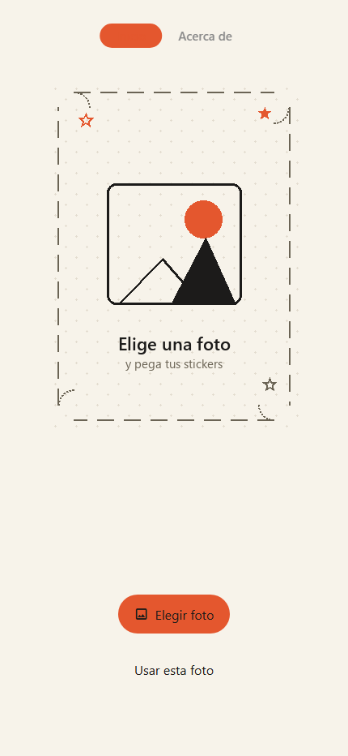
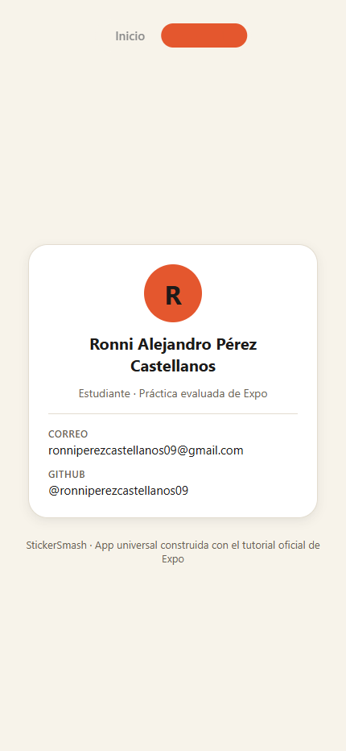

# StickerSmash 📸✨

App multiplataforma (Android, iOS y web) construida con **Expo SDK 58**, **Expo Router**, **TypeScript estricto** y componentes nativos de **Expo UI**, siguiendo el [tutorial oficial de Expo](https://docs.expo.dev/tutorial/introduction/) (8 capítulos) y con una identidad visual propia: **«Papel y tinta»** — papel cálido de fondo, tinta casi negra y un vermellón de escritura como acento.

## Estudiante

| | |
|---|---|
| **Nombre** | Ronni Alejandro Pérez Castellanos |
| **Correo** | ronniperezcastellanos09@gmail.com |
| **GitHub** | [@ronniperezcastellanos09](https://github.com/ronniperezcastellanos09) |

## Evidencia (export web estático)

Capturas tomadas con Edge headless (Chrome DevTools Protocol) sobre el resultado de `npx expo export --platform web`, a 430×932.

| Pantalla Inicio | Pantalla Acerca de |
|:---:|:---:|
|  |  |

## Recorrido del tutorial (un commit por capítulo)

| Capítulo | Commit | Contenido |
|:---:|:---:|---|
| 1. Creación del proyecto | `5f0c6a3` | `npx create-expo-app@latest` con plantilla TypeScript + Expo Router (`src/app`), configuración de rutas con `@/*`. |
| 2. Navegación | `25b955b` | Dos pantallas con pestañas nativas (`NativeTabs` de `expo-router/native-tabs`): **Inicio** y **Acerca de**, más pantalla «no encontrada». |
| 3. Diseño de pantallas | `b683361` | Vista principal con Flexbox: `ImageViewer` (320×440), botones por plataforma (`button.tsx` / `.android` / `.ios` con `@expo/ui`), tarjeta de estudiante en «Acerca de» y tokens de tema en `src/constants/theme.ts`. |
| 4. Selector de imágenes | `dbe3d9d` | `expo-image-picker` con `allowsEditing` para elegir una foto de la galería o de la web. |
| 5. Modal | `6b585fc` | `BottomSheet` de `@expo/ui` con selector de 6 stickers propios (3 columnas), botón circular «añadir» y fila de opciones (reiniciar / guardar). |
| 6. Gestos | `6cf5ba2` | Stickers arrastrables y con doble toque para escalar (2×), usando los hooks de React Native Gesture Handler v3 y Reanimated, con `clamp` para que el sticker no salga de la imagen. |
| 7. Captura de pantalla | `0f21cbf` | `react-native-view-shot` + `expo-media-library`: en nativo se guarda en la galería (con permiso `writeOnly`), en web se descarga como JPEG vía `data-uri`. |
| 8. Configuración | `392d7f6` | Barra de estado clara, splash screen en papel `#F7F3EA` e icono adaptativo de Android con fondo de tinta. |
| Corrección | `401bb5a` | Se eliminó `src/app/index.tsx` (plantilla) que colisionaba con `(tabs)/index.tsx` por la ruta `/`. |

## Funcionalidades

- **Pestañas nativas** Inicio / Acerca de, con iconos y colores de la identidad.
- **Elegir foto** desde la galería del dispositivo o del equipo, con recorte (`allowsEditing`).
- **Usar esta foto** sin pasar por el selector.
- **Añadir stickers** de emoji desde un *bottom sheet*; los stickers son PNG propios (círculo de papel con sombra vermellona desplazada y rasgos de tinta).
- **Arrastrar** el sticker y **doble toque** para escalarlo, limitados al área de la imagen.
- **Guardar** la composición: galería de fotos en Android/iOS, descarga del navegador en web.
- Interfaz íntegramente en **español** y contrastes que cumplen WCAG AA.

## Identidad visual «Papel y tinta»

Todos los colores se definen una sola vez en [`src/constants/theme.ts`](src/constants/theme.ts) y se usan en toda la app:

| Token | Valor | Uso |
|---|---|---|
| `background` | `#F7F3EA` | Papel cálido de fondo (incluido splash e icono adaptativo) |
| `ink` | `#1C1B1A` | Texto e iconos (≈15:1 sobre papel) |
| `muted` | `#6B6455` | Texto secundario (≈5.3:1) |
| `accent` | `#E4572E` | Botón primario, monograma, pestaña activa |
| `accentText` | `#B03A17` | Enlaces sobre papel (≈5.5:1) |
| `onAccent` | `#1C1B1A` | Contenido sobre el acento |
| `surface` / `border` | `#FFFFFF` / `#E3DCCF` | Tarjetas y bordes |

## Cómo ejecutar

```bash
# 1. Instalar dependencias
npm install

# 2. Iniciar el servidor de desarrollo (abre Android, iOS o web)
npx expo start
```

En el terminal de `expo start` puedes pulsar `a` (emulador Android), `i` (simulador iOS), `w` (navegador) o escanear el QR con Expo Go.

## Verificación

```bash
# TypeScript estricto, sin errores
npx tsc --noEmit

# Export estático de la web (6 rutas)
npx expo export --platform web
```

## Estructura del proyecto

```
src/
├── app/
│   ├── _layout.tsx            # Stack raíz + GestureHandlerRootView + StatusBar
│   ├── +not-found.tsx         # Ruta no encontrada
│   └── (tabs)/
│       ├── _layout.tsx        # NativeTabs Inicio / Acerca de
│       ├── index.tsx          # Pantalla principal (capítulos 3–7)
│       └── about.tsx          # Tarjeta de estudiante
├── components/
│   ├── button.tsx / .android.tsx / .ios.tsx
│   ├── circle-button.tsx / .android.tsx / .ios.tsx
│   ├── icon-button.tsx / .android.tsx / .ios.tsx
│   ├── emoji-picker.tsx       # BottomSheet de @expo/ui
│   ├── emoji-list.tsx         # FlatList de 6 stickers (3 columnas)
│   ├── emoji-sticker.tsx      # Sticker con gestos y animación
│   └── image-viewer.tsx       # expo-image con placeholder/selección
└── constants/
    └── theme.ts               # Tokens de color «Papel y tinta»
```

## Dificultades encontradas y soluciones

1. **`npm install` colgado y `node_modules` corrupto.** Una instalación en segundo plano quedó estancada y dejó 36 entradas sin `version` en `package-lock.json`, carpetas de paquetes vacías y TTF sin extraer (fallaba con `Invalid Version:` y el export no resolvía `MaterialSymbols_400Regular.ttf`). Se diagnosticó con Arborist/`loadActual`, se depuraron quirúrgicamente las entradas del lockfile y se reparó todo con `npm ci` (613 paquetes).
2. **Colisión de rutas en la web.** El export estático mostraba «Edit src/app/index.tsx» en `/` porque la pantalla plantilla `src/app/index.tsx` competía con `src/app/(tabs)/index.tsx`. Se eliminó el archivo sobrante, se limpiaron `dist/` y `.expo/` y se re-exportó.
3. **Capturas headless en blanco.** El modo `--screenshot` de Edge headless capturaba antes de que React hidratara la página. Se resolvió con un script propio basado en Chrome DevTools Protocol que espera a `Page.loadEventFired` + un margen de pintado antes de capturar, y con un servidor estático que reescribe `/about` → `about.html`.
4. **Stickers propios.** En lugar de reutilizar los assets del tutorial se generaron 6 PNG (200×200) con Pillow, siguiendo la identidad: círculo de papel, sombra vermellona desplazada y rasgos de tinta, con supermuestreo 4× para bordes suaves.

## Recursos

- [Tutorial oficial de Expo](https://docs.expo.dev/tutorial/introduction/)
- [Expo Router](https://docs.expo.dev/router/introduction/) · [Expo UI](https://docs.expo.dev/develop/ui/) · [Expo Image Picker](https://docs.expo.dev/develop/image-picker/) · [Gesture Handler](https://docs.expo.dev/develop/gestures/)
